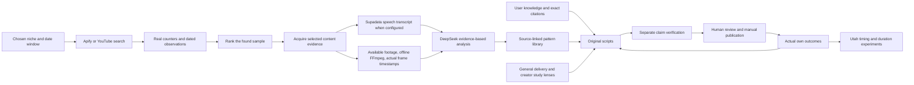

# Source investigation and resulting implementation

The five repositories supply useful ideas, but do not collectively supply a complete, validated viral-research product. TIKY TOKY is a new integrated implementation with source reviews retained separately. Static inspection is not a runtime certification of those upstream projects.

## Evidence → finding → implementation path

| Evidence | Finding | Implementation path |
| --- | --- | --- |
| [videoanalyzer source audit](research/analysis-engines.md), commit `aa0c88ade21f4a12b47d02f5c757ed8e566dca90` | Preprocessing plus an agent prompt, not topic discovery or a standalone analysis service | Original evidence and AI modules, explicit source coverage |
| [HOOK_ANALYZER source audit](research/analysis-engines.md), commit `e03d930b3f19f412be1f02c33dad2d414cd14101` | Synthetic retention/training labels, incomplete licensing and unexpected remote upload behavior | No upstream code copied; no retention curve presented as measured; explicit provider boundaries |
| [AdLab source audit](research/extraction-and-adlab.md), commit `59f792a5546c00b0a377ea550e065e9ea26e696e` | Valuable creative framework; discovery is an unbuilt plan and extraction is external | Original hook/story/CTA research plus provider-backed discovery |
| [TikTok Video Analyzer source audit](research/extraction-and-adlab.md), commit `484ae10d508e902354bd2acd971b0c0839480bcb` | Real extraction CLI, but missing discovery/ranking/generation and flawed metadata/timestamp handling | Structured metadata, genuine observation history, source timestamps, content extraction |
| [TikTok Analytics source audit](research/metrics-and-discovery.md), commit `d0afad7bdbc333b27dcc1d686eaeba1363aa0b44` | Own-account APIs are not arbitrary niche discovery; source contains invented historical baseline behavior | Apify search sampling, actual snapshot growth, null unknowns, no backdated metrics |

## How the integrated system studies content

Automatic study is bounded to five selected examples per action. It requests usable footage, samples actual frames with the decoder's timestamps, retrieves speech when configured, and reports missing evidence. It does not continuously watch/listen to every video, infer a real retention curve, or certify worldwide coverage.

## Creator study source boundaries

The seven names and study focuses came from the user. Reference checks used creator-owned or creator-linked pages on October 19, 2026: [Alex Hormozi/Acquisition.com](https://www.acquisition.com/), [hook-retain-reward book material](https://shop.acquisition.com/products/workbook-3-pack-digital), [Zach King](https://www.zachkingmagic.com/), [Nick Grigolia](https://linktr.ee/nickgrigolia), [Maren Altman](https://linktr.ee/marenaltman), [May Like the Month](https://www.maylikethemonthh.com/), and [Moon Omens](https://www.moonomens.com/). MrBeast's website timed out; his channel remains a user-named reference, without a claim that a video sample was analyzed. These checks establish reference identity or published offerings, not performance causation, conversion rates, or prediction accuracy.

## Verification and unresolved external requirements

See [VERIFICATION.md](VERIFICATION.md) for final checks. TikTok discovery needs Apify credentials/credits and live account validation. Speech extraction needs Supadata or a supplied transcript. Vercel source readiness and local production verification are separate from actual cloud deployment. The implementation enforces evidence boundaries and rejects invalid output; AI consistency checking remains fallible.
